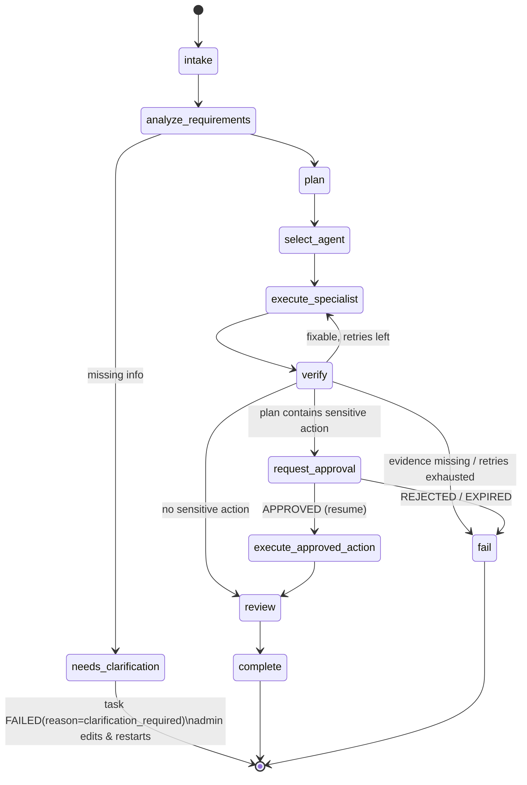

# Agent Design

An agent is configuration + code, registered in the `agents` table and the in-code
registry:

```python
class AgentDefinition(BaseModel):
    key: str                      # "cio", "devops", ...
    display_name: str
    department: str               # used by the 3D office layout
    model_profile: str            # "reasoning" | "fast" | ...
    system_prompt_ref: str        # versioned prompt file
    allowed_tools: frozenset[str] # checked again by the policy engine
    max_steps: int
    max_concurrency: int
    enabled: bool
```

Future roles (Research, Marketing, Sales, Support) are added by registering a new
definition and tools; the orchestration graph does not change.

## AI CIO (Sprint 1)

Coordinator and the admin's primary interface. Implemented as the top-level LangGraph
graph. **Predictable, fixed topology** in Sprint 1 — no dynamic multi-agent planning yet.



Typed graph state (Pydantic):

```python
class CioState(BaseModel):
    task_id: UUID
    project_id: UUID
    request: str
    requirements: Requirements | None
    plan: ExecutionPlan | None          # ordered steps, each with agent_key + inputs
    specialist_result: SpecialistResult | None
    verification: VerificationResult | None
    pending_approval_id: UUID | None
    summary: OutcomeSummary | None      # outcome, risks, next steps, evidence refs
    error: TaskError | None
```

Restrictions (enforced, not just prompted): cannot decide approvals; cannot call
repository tools directly; cannot mark `COMPLETED` without a passing `VerificationResult`.

## DevOps Engineer (Sprint 1)

A specialist subgraph invoked by `execute_specialist`. Sprint 1 scope: read-only CI/CD
analysis of an authorized repository.

Flow: `discover` (list tree, filter CI/CD-relevant paths) → `read` (bounded file reads) →
`analyze` (LLM with structured output) → `report`.

Output contract:

```python
class CicdRecommendation(BaseModel):
    repository: str                     # owner/name, must be on allowlist
    files_inspected: list[FileEvidence] # path + blob sha + byte size
    findings: list[Finding]             # severity, category, file, line range, description
    recommendations: list[Recommendation]  # title, rationale, proposed change (diff text, not applied), effort, risk
    limitations: list[str]
```

**Verification** (in the CIO graph, deterministic code — not another LLM call): every
finding references a file in `files_inspected`; every referenced blob sha was actually
fetched in this execution; schema valid; no secret-like strings in output.

## Sprint 1 sample sensitive action

After the report passes verification, the CIO proposes
`report.publish_external(target="mock://reports/{project}", parameters={report_id})`.
It goes to the approval queue; on approval the **mock** adapter records the
"publication". This exercises the full approval path without any real external effect.

## Agent status for the UI

Derived server-side from the agent's most recent execution, published as events:

| Agent status | Source |
|---|---|
| `IDLE` | no active execution |
| `RUNNING` | an execution in `RUNNING` |
| `WAITING_APPROVAL` | task of active execution in `WAITING_APPROVAL` |
| `FAILED` | last execution failed (until acknowledged or next run) |
| `COMPLETED` | transient, emitted on completion event |
