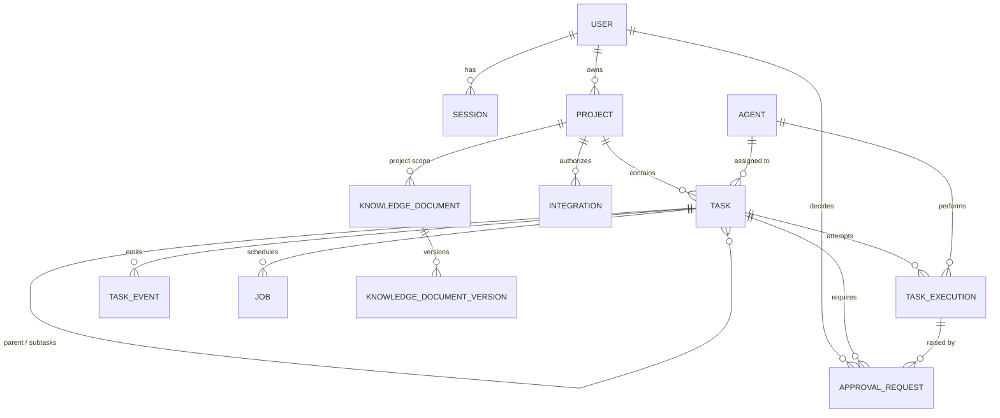
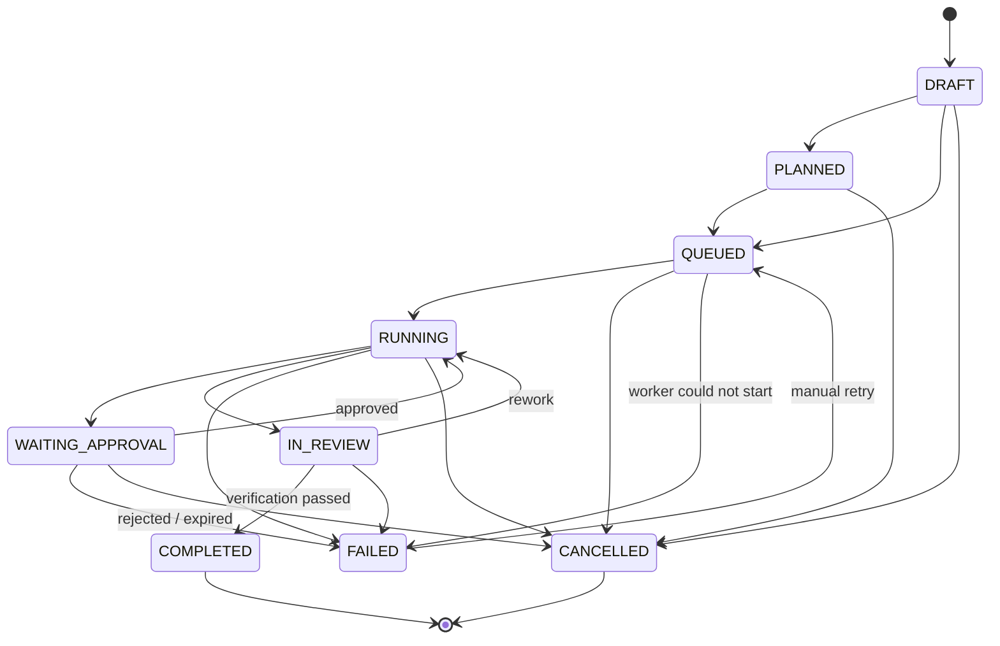

# Data Model

Design for Sprint 1 migrations. All ids are UUIDv7 (time-ordered) except the
append-only logs, which use `bigint` identity ids for ordering and SSE replay. All
timestamps are `timestamptz` in UTC. Every project-scoped table carries `project_id`.

## Entity relationship diagram

## Entities

### users
`id, email (unique, citext), display_name, password_hash, role ('admin'), is_active,
created_at, last_login_at`

### sessions
`id, user_id → users, token_hash (unique), created_at, last_seen_at, expires_at,
revoked_at, ip, user_agent`

### projects
`id, key (unique slug), name, description, client_name (nullable), status
('active'|'archived'), owner_id → users, created_at, updated_at`

### agents
`id, key (unique: 'cio', 'devops', …), display_name, department, model_profile,
config (jsonb: overrides, limits), enabled, created_at, updated_at`
Seeded from the code registry; the code registry is the source of truth for tools.

### tasks
`id, project_id → projects, parent_task_id → tasks (nullable), title, request (text),
status (enum below), assigned_agent_id → agents (nullable), priority, created_by → users,
acceptance_criteria (jsonb), result (jsonb, nullable), failure_reason (nullable),
version (int, optimistic locking), created_at, updated_at, completed_at`
Index: `(project_id, status)`, `(assigned_agent_id, status)`.

### task_executions
`id, task_id → tasks, agent_id → agents, attempt (int), status ('running'|'succeeded'|
'failed'|'cancelled'|'interrupted'), graph_thread_id, input (jsonb), output (jsonb),
error (jsonb), model_provider, model_name, tokens_in, tokens_out, cost_usd (numeric),
started_at, finished_at`
Unique: `(task_id, agent_id, attempt)`.

### task_events (append-only)
`id bigint identity, task_id, project_id, execution_id (nullable), agent_id (nullable),
type ('status_changed'|'step_started'|'step_finished'|'tool_called'|'approval_requested'|
'approval_decided'|'log'|…), payload (jsonb, redacted), created_at`
Used for history, SSE replay and the 3D office.

### approval_requests
`id, task_id, project_id, execution_id, requested_by_agent_id, action_type, target,
parameters (jsonb), action_hash (char(64)), justification, expected_impact,
risk_level ('low'|'medium'|'high'|'critical'), evidence (jsonb refs),
status ('pending'|'approved'|'rejected'|'expired'|'cancelled'), decided_by → users,
decision_note, decided_at, expires_at, consumed_at, created_at`
Check: `decided_by IS NOT NULL` when status in (approved, rejected).

### integrations
`id, project_id → projects, provider ('github'|…), name, config (jsonb, e.g.
allowed_repos), secret_ref (name of the secret, never the value), scopes (text[]),
enabled, created_at, updated_at`

### knowledge_documents (Sprint 3; designed now)
`id, scope ('company'|'project'), project_id (required iff scope='project'), title,
kind, current_version_id, trust ('approved'|'unverified'), created_by_user_id |
created_by_agent_id, created_at, updated_at`
**knowledge_document_versions:** `id, document_id, version, content, source (provenance),
created_by…, created_at` — immutable rows.

### audit_events (append-only, tamper-evident)
`id bigint identity, actor_type ('user'|'agent'|'system'), actor_id, action, project_id
(nullable), resource_type, resource_id, details (jsonb, redacted), prev_hash, hash,
created_at`
The app's DB role has `INSERT, SELECT` only.

### jobs
See ADR-0003.

## Task status machine

Rules:
- Transitions are implemented once in `domain/task_state.py` and covered by a
  table-driven test; any other transition raises.
- `COMPLETED` is reachable only from `IN_REVIEW` with a stored passing verification.
- `FAILED → QUEUED` only by a human, creating a new execution attempt.
- Every transition writes a `task_events` row and an `audit_events` row in the same
  transaction, with optimistic locking on `tasks.version`.
