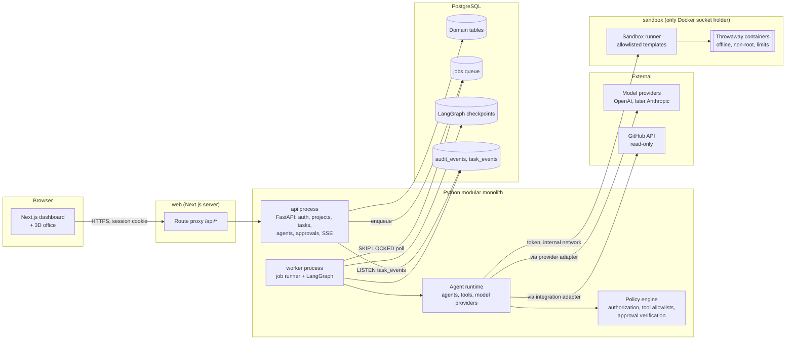
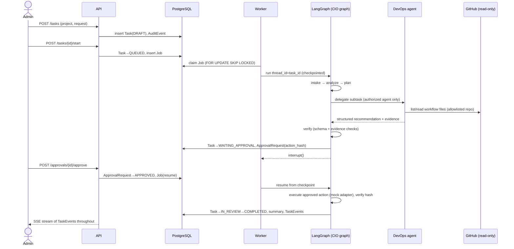

# Architecture Overview

Agent HQ is a **modular monolith**: one Python codebase deployed as two processes
(`api` and `worker`) sharing one PostgreSQL database, plus a Next.js web client.

## Component diagram

The browser never talks to model providers or integrations, and never holds credentials
other than its own HttpOnly session cookie.

## Layers and their code homes

| Layer | Responsibility | Location (`apps/api/src/agent_hq/`) |
|---|---|---|
| API | HTTP routes, auth, request validation, SSE | `api/` |
| Domain | Entities, enums, state machine, invariants | `domain/` |
| Persistence | SQLAlchemy models, repositories, Alembic | `db/`, `migrations/` |
| Orchestration | LangGraph graphs, nodes, checkpointer, job runner | `orchestration/` |
| Agent runtime | Agent definitions, tool registry, model providers | `agents/`, `tools/`, `llm/` |
| Security | Policy engine, approvals, redaction, secrets access | `security/` |
| Knowledge | The Brain (Sprint 3) | `knowledge/` |
| Integrations | GitHub, messaging, MCP (adapters behind interfaces) | `integrations/` |
| Events | Task events, audit log, pub/sub over `pg_notify` | `events/` |

Modules are created only when they get real code (no empty packages).

## Request lifecycle (Sprint 1)

## Key mechanisms

**Durable execution.** API never runs agents inline. It writes a `jobs` row; the worker
claims it with `SELECT … FOR UPDATE SKIP LOCKED`, heartbeats it, and runs the LangGraph
graph with `thread_id = task_id` using the PostgreSQL checkpointer. A crashed worker's
job lease expires and another worker resumes from the last checkpoint. See ADR-0003.

**Real-time updates.** Every state change appends a `task_events` row (monotonic
`bigint` id) and issues `pg_notify('task_events', id)`. The API holds one `LISTEN`
connection and fans out to SSE clients. Clients reconnect with `Last-Event-ID` and the
API replays from the table, so no events are lost. See ADR-0004.

**Human approval.** A graph node calls LangGraph `interrupt()` after persisting an
`ApprovalRequest` whose `action_hash` is SHA-256 over the canonical JSON of
`{action_type, target, parameters}`. On resume, the tool layer recomputes the hash and
refuses to execute unless an `APPROVED`, unexpired, unconsumed approval matches it;
the approval is then marked consumed (single use). See ADR-0006.

**Tool policy.** Every tool is declared with a `ToolSpec` (side-effect class,
idempotency, timeout, required permission). The policy engine checks
agent × tool × project × integration scope **before** invocation, server-side.
See [../security/permission-matrix.md](../security/permission-matrix.md).

**Model providers.** Agents ask for a *model profile* (e.g. `reasoning`, `fast`), not
a model name. Profiles map to `provider:model` in configuration, overridable per agent
and per task. A deterministic `mock` provider backs all tests. See ADR-0005.

## Deployment shape

- **Local (Sprint 0–5):** Docker Compose — `db`, `api`, `worker`, `web`.
- **Cloud (Sprint 6):** decide then between a single VM, ECS/Fargate or App Runner, with
  RDS PostgreSQL. Kubernetes only if scale demands it.

## Observability

- Structured JSON logs with `request_id`, `task_id`, `execution_id`, `agent`, with
  secret redaction applied in the logging pipeline.
- OpenTelemetry tracing (FastAPI, SQLAlchemy, outbound HTTP, LangGraph node spans),
  exporter configurable via standard `OTEL_*` variables; off by default locally.
- Metrics: task counts by status, execution duration, model tokens and estimated cost,
  approval latency, job queue depth.
